  

  
  
  

### About me

Third-year **Computer Science** student at Ashkelon Academic College and co-founder of **Medusa Dynamics**, a small development and AI studio.
I build systems end to end, from architecture docs to production, and I work with AI coding agents (Claude Code, Codex) every day.
Before tech: data communications technician and platoon sergeant in IDF Unit 828.

### Selected work

<table>
  <tr>
    <td width="50%" valign="top">
      <h4><a href="https://numra.co.il">Numra</a> &nbsp;</h4>
      Real-time classroom math race. Server-authoritative game engine, multiplayer over SSE on a 250&nbsp;ms tick, ~1,400 automated tests. Team project.  
      
      
      
      
      
    </td>
    <td width="50%" valign="top">
      <h4>Toranu &nbsp;</h4>
      Multi-tenant appointment SaaS for service businesses. Row-level security, database-level double-booking prevention, embeddable booking widget.  
      
      
      
      
      
    </td>
  </tr>
  <tr>
    <td width="50%" valign="top">
      <h4>Agent Control Center &nbsp;</h4>
      Live dashboard for Claude Code and Codex sessions, with task delegation between agents over MCP. Dependency-free Python server.  
      
      
      
    </td>
    <td width="50%" valign="top">
      <h4><a href="https://github.com/noam1a1/ui-ux-compass">ui-ux-compass</a> &nbsp;</h4>
      Claude skill that interviews first, picks from ~95 design styles, maps every screen and state, and plans before any code is written.  
      
      
    </td>
  </tr>
  <tr>
    <td colspan="2" valign="top">
      <h4><a href="https://karolinaclinic.co.il">Karolina Clinic</a> &nbsp;</h4>
      Client website for a beauty clinic, from design plan to production on a custom domain. &nbsp;
      
      
      
    </td>
  </tr>
</table>

Most product and client code is private. Happy to walk through it in an interview.

### Tech stack

   
  

### Let's talk

Looking for a **student developer position or internship**. The fastest way to reach me is [LinkedIn](https://www.linkedin.com/in/noamapter/).
